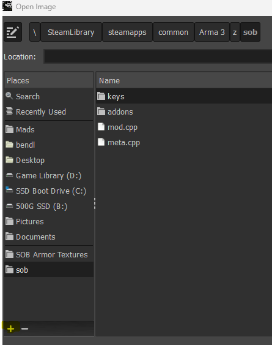
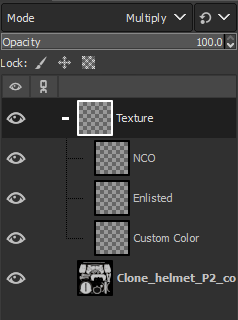
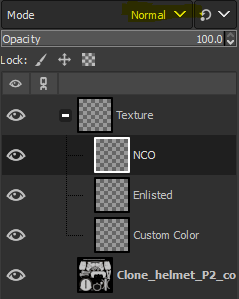
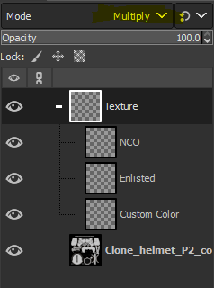
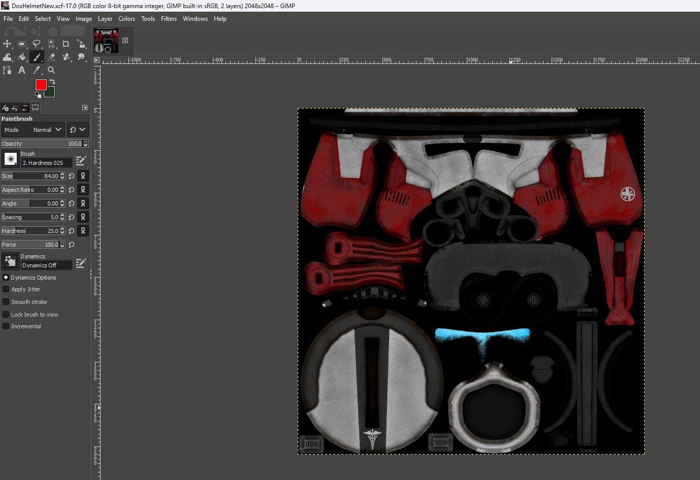
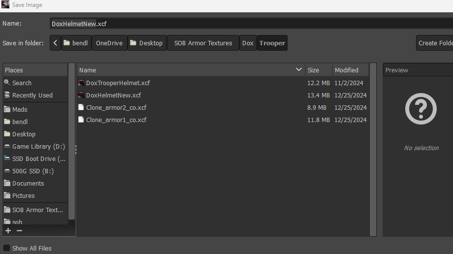

> **2D TEXTURING · GIMP**  
> Learn the team's 2D workflow, from plugin installation through in-game testing.

# How to 2D Texture

### Step 1: Download and follow the prompts to install GIMP 2.0.

[Link](https://download.gimp.org/gimp/v2.10/windows/gimp-2.10.38-setup.exe)

### Step 2: Download the Gimp PAA plugin.

[Link](https://drive.google.com/file/d/146fu1sY9jbUKBMas_Z3c3naPvTwtiz_U/view?usp=drive_link)

PLUGIN ONLY WORKS ON THE OLDER VERSION OF GIMP PROVIDED ABOVE

### Step 3: Place the plugin in your gimp plugin folder.

`Program Files\GIMP 2\lib\gimp\2.0\plug-ins`

### Step 3: Open GIMP

### Step 4: Go into your file browser and set bookmarks to the Z drive.

### Step 5: Open a base file.

[GitHub](https://github.com/Rowdy-Rodent-Industries/rri_texture_team)

### Step 6: Create a layer group with a layer for each color used.

- NCO Grey: `#343434`

- Enlisted Grey: `#646464`

- Custom Color: `#RRGGBB`

### Step 7: Set the layer group mode to Multiply and the layers in the group to Normal.

### Step 8: Texture your armor.

### Step 9: Save as a separate file.

### Step 10: Export into Arma 3 to test your texture.

[Uploading Textures into Arma 3](uploading-textures-into-arma.md)

---

[← Wiki Home](/) · [Texture Rules](texture-rules) · [Naming Reference](texture-name-system)
