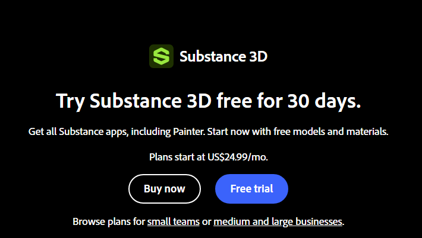
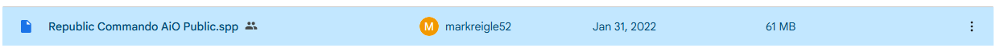
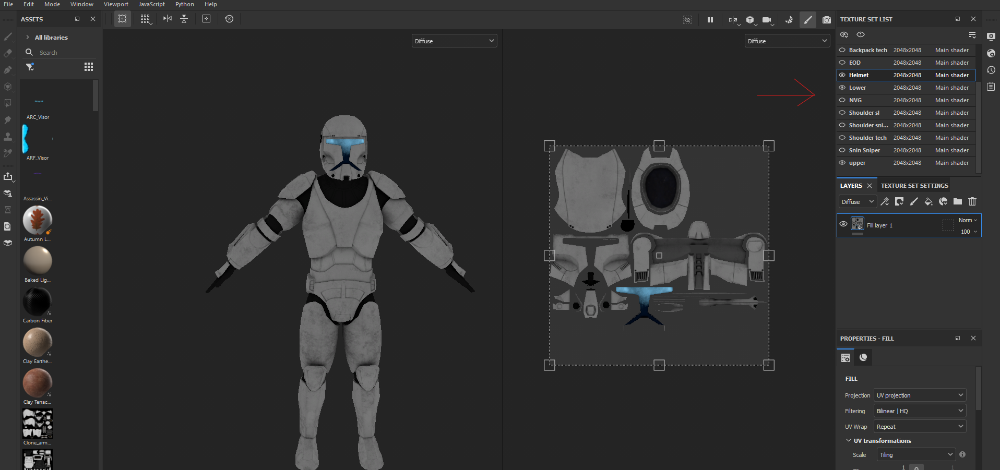
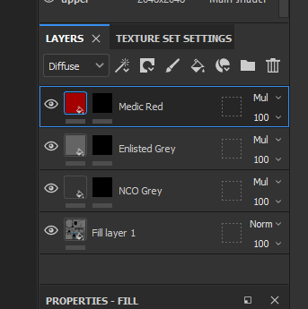
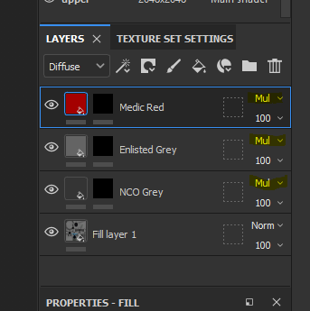
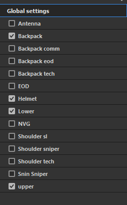
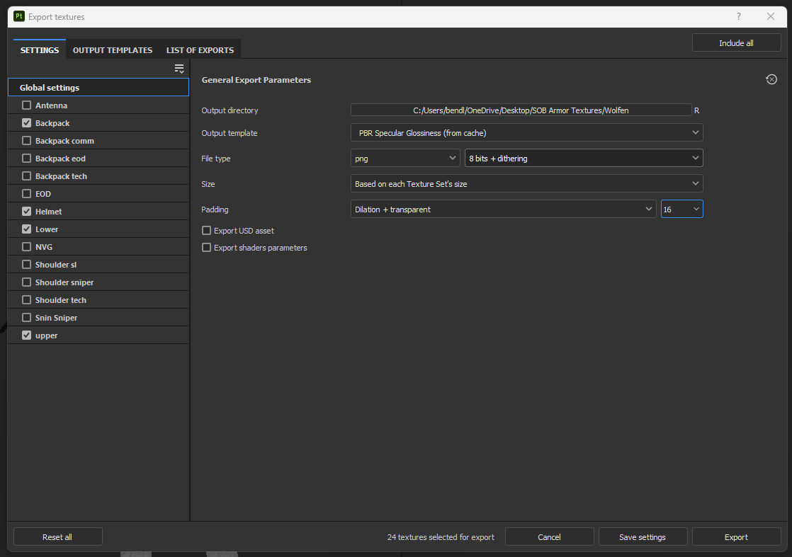
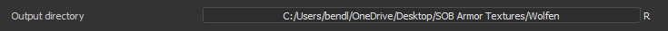
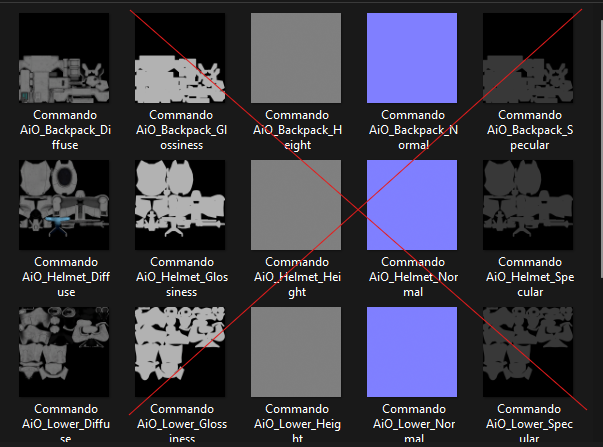
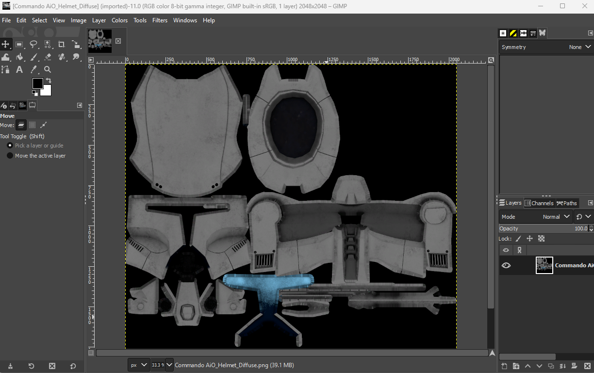

> **3D TEXTURING · SUBSTANCE PAINTER**  
> Set up armor projects, paint layers, export textures, and prepare files for testing.

# How to 3D texture

## Part 1: Setting up

### Step 1: Obtain and Install Adobe Substance Painter

[Link](https://www.adobe.com/creativecloud/3d-ar/campaign/pricing.html?sdid=DRCF12SK&mv=search&mv2=paidsearch&gad_source=1&gad_campaignid=20186236523&gbraid=0AAAAADraYsJoT_BL81M596W23x_xbqyRL&gclid=Cj0KCQiAm9fLBhCQARIsAJoNOctoWhufhFBTZOp7OBnQW6f9rr5alPoTOs83FZHrfdNr8ZMeohIS3eoaAnZwEALw_wcB)

(We do not condone piracy of any kind. We advise you that if you want to do 3D texturing that you pay for the licensing for Adobe Substance Painter.)

### Step 2: Access the 3D Library used for SOB armors.

[Link](https://github.com/Rowdy-Rodent-Industries/rri_texture_team)

### Step 3: Download the spp of the armor you want to texture and open it in Substance Painter.

## Part 2: Texturing

### Step 1: Use the hide tool to only show the pieces you wish to edit.

### Step 2: Create layers for each color to be used.

Press the bucket button to create a fill layer, then press the button of a circle inside a square to create a black mask.

- NCO Grey: `#343434`

- Enlisted Grey: `#646464`

- Chosen Color: `#RRGGBB`

### Step 3: Set layers to multiply

### Step 4: Design armor as requested with available tools.

## Part 3: Exporting Textures

### Step 1: Select “File” and “Export Textures”

### Step 2: Select all pieces of the armor you wish to export.

### Step 3: Use the following options for the export.

### Step 4: Select what folder you want the files to export to.

### Step 5: Go into the export folder and delete the extra files.

### Step 6: Open the files in GIMP

### Step 7: Refer to the Uploading texture into Arma 3 document to test your armor.

[Link](uploading-textures-into-arma)

### Step 8: Save these 2D files and use the proper naming format.

## Commando Names

- Helmet: `Helmet_(Name)_co`

- Upper: `Camo1_(Name)_co`
- Lower: `Camo2_(Name)_co`

- Backpack: `Backpack_(Name)_co`

---

[← Wiki Home](/) · [Texture Rules](texture-rules) · [Naming Reference](texture-name-system)
