> **ARMA 3 · LOCAL TESTING**  
> Preview texture changes locally using the team's file-patching workflow.

# Uploading texture into Arma 3

## Part 1: Setting up your local folder to override the mod textures.

### Step 1: Download PBO Manager

[Link](https://www.moddb.com/downloads/pbo-manager-v14)

### Step 2: Locate your Arma 3 Folder.

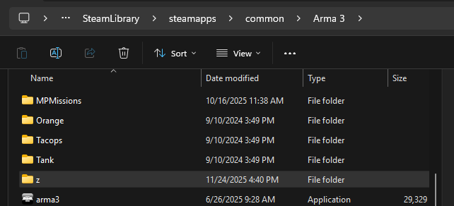

This folder will typically be in your steamapps/common directory. Locate this file path.

### Step 3: Create a folder labeled “z”

### Step 4: Create a folder in the z folder labeled “sob”

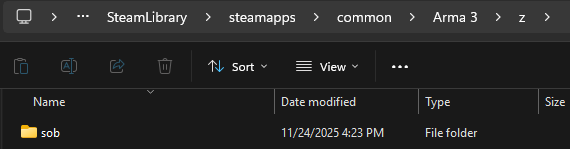

### Step 5: Ensure hidden files are visible.

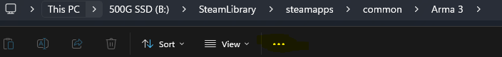

Press options and go to view.

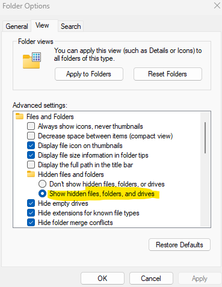

### Step 6: Go into the !Workshop folder and locate the Special Operations Brigade folder.

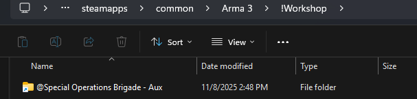

### Step 7: Copy all files and folders

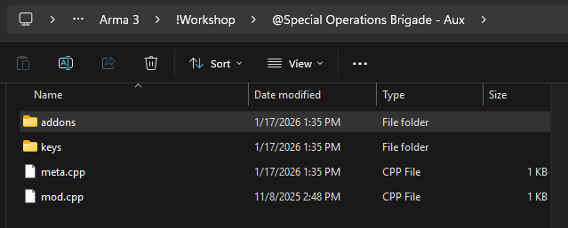

### Step 8: Place these file copies into your “sob” folder you previously made.

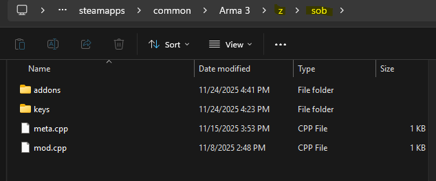

### Step 9: Export the “sob_equipment” pbo and place the files in a folder named “equipment”.

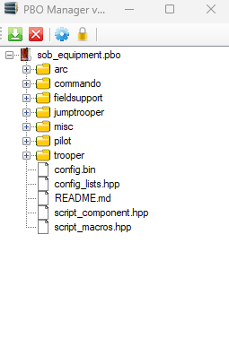

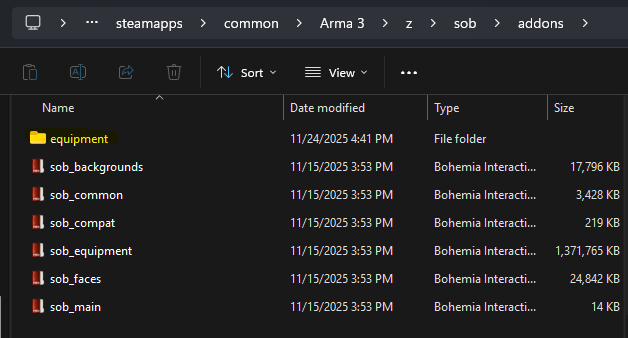

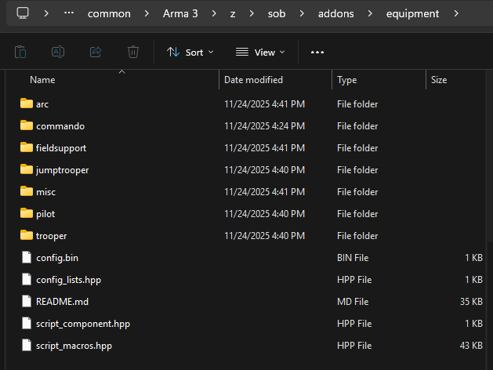

## Part 2: Uploading texture and viewing them in Arma 3.

### Step 1: Open your file you wish to upload in Gimp.

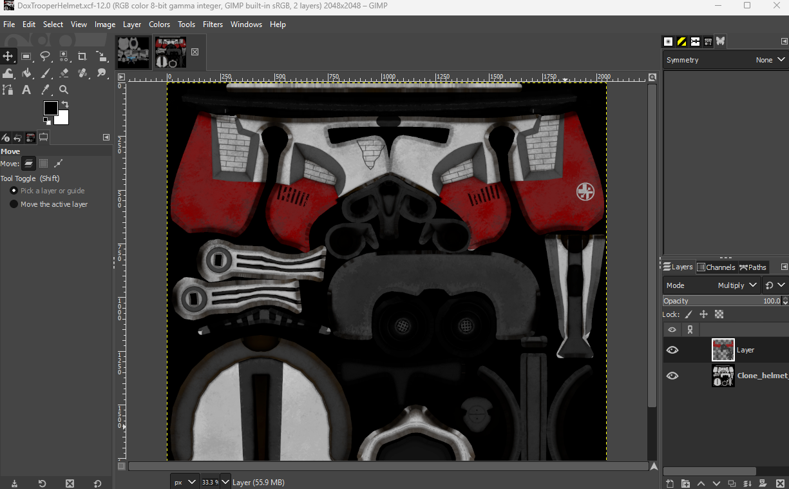

### Step 2: Click on “file” and “export as”.

### Step 3: Locate the equipment folder you previously made in part 1.

### Step 4: Open the location of the same type of armor you are looking to use.

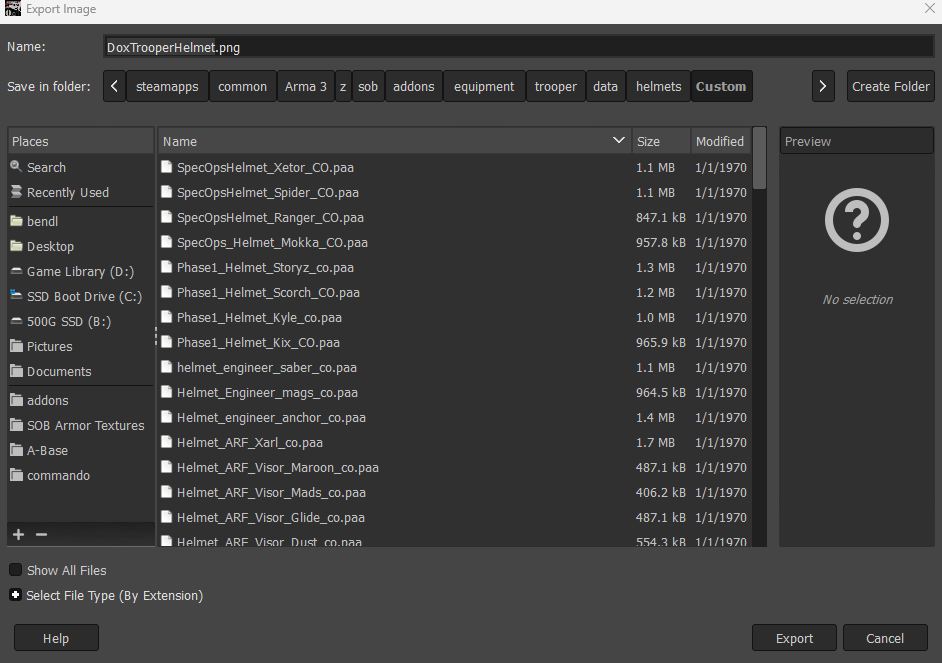

Example: If you are wanting to upload a P2 Helmet, open the trooper folder and go into helmets. Find someone's helmet that has the same helmet type as the one you are testing. This means if you have an engineer helmet you made, upload it to someone's helmet who also is using the engineer helmet.

### Step 5: Export your file onto the file you are overwriting.

It does not matter whose file you choose, as long as it is the exact same type of armor.

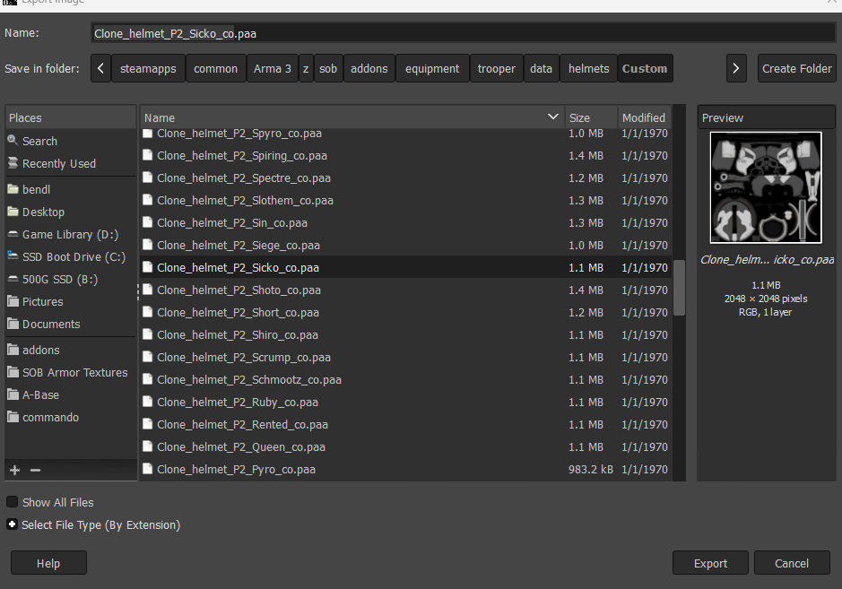

### Step 6: Open the Arma 3 launcher.

### Step 7: Go into parameters in the launcher and ensure the box next to “Enable File-Patching” is checked.

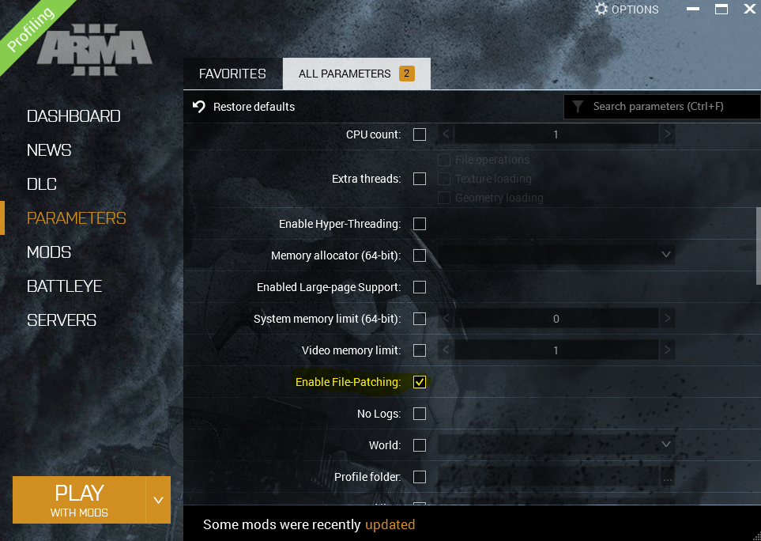

### Step 8: Launch Arma with the “Special Operations Brigade Aux” enabled.

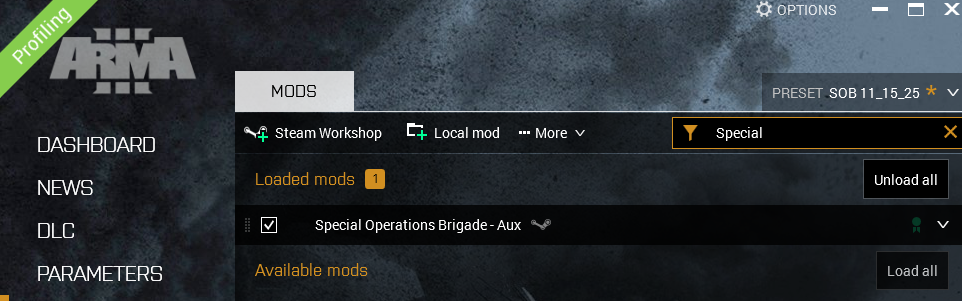

### Step 9: Go into the arsenal editor and find the texture of the file you exported onto.

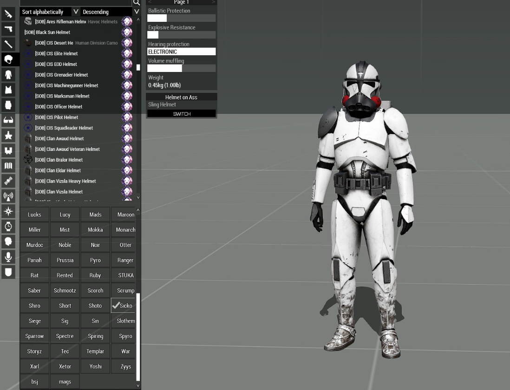

## Notes

You must have file patching enabled only when doing textures. If you have it enabled when attempting to attend ops, it will not let you join.

Exporting onto someone else's file will not delete their file as you are only editing the duplicate you made for testing.

---

[← Wiki Home](/) · [Texture Rules](texture-rules) · [Naming Reference](texture-name-system)
